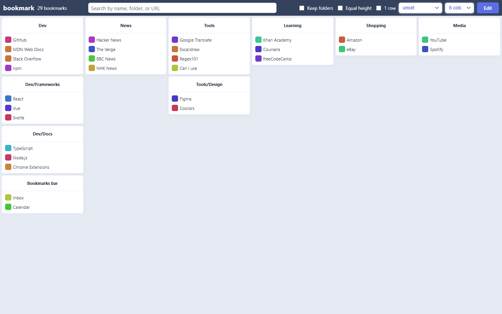
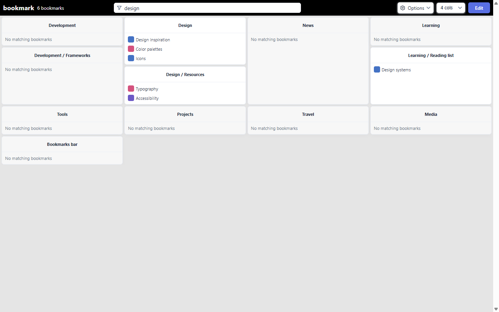

# Chrome Bookmark Extension

A compact Chrome extension that turns the bookmarks bar into a searchable panel-based workspace.

The extension reads and organizes Chrome's existing bookmarks, but it does not collect, transmit, or sell bookmark data. All bookmark operations and preferences stay in the browser.

## Screenshots

| Panel overview | Search |
| --- | --- |
|  |  |
| 3, 6, or 10-column layouts organize every folder under the bookmarks bar. | Search by bookmark name, folder path, or URL. |

| Edit mode | Equal-height layout |
| --- | --- |
|  |  |
| Rename, add, delete, and drag items to reorganize your bookmarks. | Display panels in a flexible equal-height layout with adjustable row limits. |

## Features

- Displays every folder under the bookmarks bar as a panel.
- Shows nested folder paths such as `Dev / Docs`.
- Stacks subfolders under their top-level folder by default.
- Searches bookmark titles, full folder paths, and URLs.
- Supports AND-style search terms, for example `dev docs`.
- Keeps folders visible during search with **Keep folders**.
- Shows Chrome favicons with a fallback icon when unavailable.
- Opens bookmarks in a new tab and blocks unsafe `javascript:` and `data:` URLs.
- Automatically reflects bookmark changes made in Chrome.

## Layout options

Choose **3**, **6**, or **10** columns and set the visible bookmark limit to **10**, **20**, **30**, or unset.

The **Options** menu also provides:

- **Keep folders** - keep folder panels visible while filtering.
- **No animation** - disable panel transitions.
- **Fit panels to page height** - distribute available height across wrapped rows and scroll long bookmark lists inside their panels. When panels cannot fit at their minimum height, the page scrolls vertically.
- **No height adjustment** - turn off automatic panel height balancing.
- **No wrap** - use one horizontal row instead of wrapping.
- **No subfolder stacking** - give every panel its own column.

## Installation

1. Open `chrome://extensions` in Chrome.
2. Enable **Developer mode**.
3. Select **Load unpacked**.
4. Choose the `extension` folder from this repository.
5. Click the extension icon to open bookmark panels in a tab.

An existing extension tab is reused when the icon is clicked again.

When updating the extension, reload it from `chrome://extensions` and accept any new permission prompts.

## Search

Enter text in the search field to filter bookmarks by partial matches in:

- Bookmark names
- Folder names and full folder paths
- URLs

Separate terms are combined as AND filters. For example, `dev docs` must match a bookmark or folder through the same search fields.

## Edit and organize

Select **Edit** to enable bookmark and folder controls.

- Use `✎` to rename a bookmark or folder.
- Use **URL** to change a bookmark URL.
- Use `+` to add a folder.
- Use `×` to delete a bookmark or folder.
- Drag a bookmark or folder with the grip handle to move it.
- Drop a bookmark or folder on the **File / Folder** area at the bottom of a panel to move it to the end of that folder.
- Drag a URL from the browser onto a bookmark or folder drop area to create a bookmark.

Folders containing child folders cannot be deleted. Deleting a folder that contains only bookmarks requires confirmation.

When a dropped URL has no useful title, the extension checks matching open tabs and uses the tab title when available.

## Privacy and permissions

- `bookmarks` - read, create, move, rename, and delete bookmarks.
- `favicon` - display each site's Chrome-fetched favicon.
- `tabs` - match dropped URLs to open tabs and reuse their titles.

The extension uses `localStorage` for layout and option preferences. Bookmark data and tab information are processed locally and are never transmitted.

## Development

The Chrome runtime files are in [`extension/`](extension/).

Run the logic tests with Node.js:

```powershell
npm test
```

Package the extension for local distribution:

```powershell
npm run zip
```

The package script creates a versioned ZIP in the repository root. For example:

```text
chrome-bookmark-extension-1.0.0.zip
```
