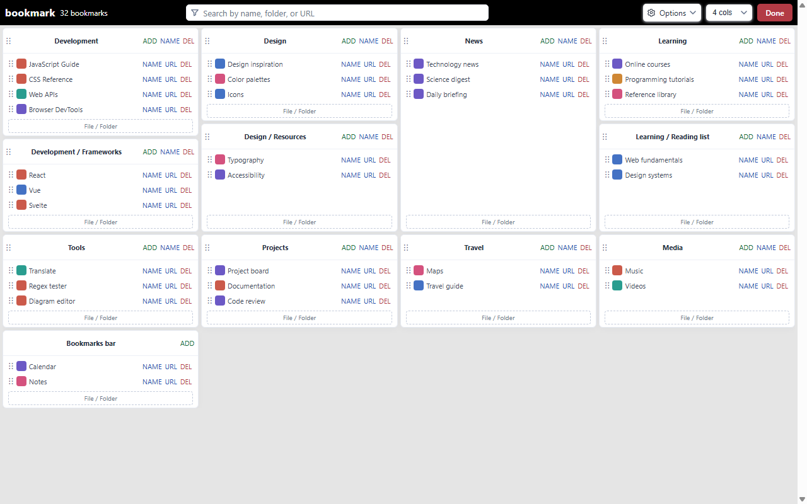
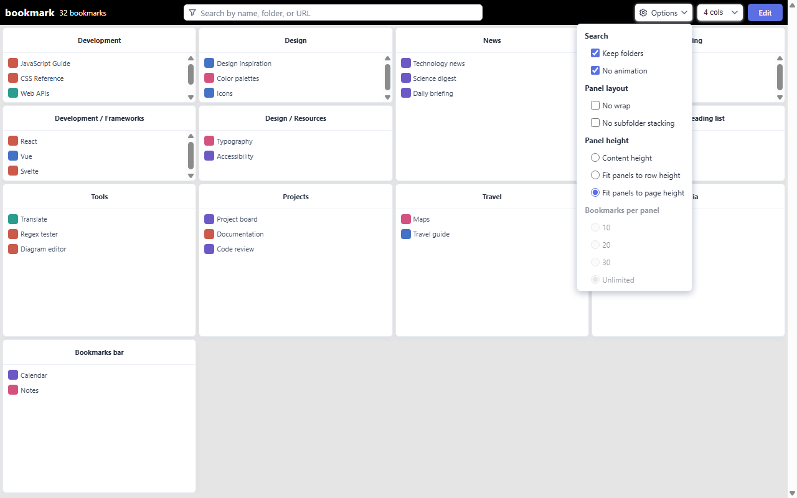

# Chrome Bookmark Extension

A compact Chrome extension that turns the bookmarks bar into a searchable panel-based workspace.

The extension reads and organizes Chrome's existing bookmarks, but it does not collect, transmit, or sell bookmark data. All bookmark operations and preferences stay in the browser.

## Screenshots

| Panel overview | Search |
| --- | --- |
|  |  |
| Folder panels organize every folder under the bookmarks bar. | Search by bookmark name, folder path, or URL. |

| Edit mode | Layout options |
| --- | --- |
|  |  |
| Rename, add, delete, and drag items to reorganize your bookmarks. | Adjust panel height, layout, and bookmark limits in Options. |

Screenshots use sample bookmarks and placeholder favicons, not personal data.

## Features

- Displays every folder under the bookmarks bar as a panel.
- Shows nested folder paths such as `Dev / Docs`.
- Stacks subfolders under their top-level folder by default.
- Searches bookmark titles, full folder paths, and URLs.
- Supports AND-style search terms, for example `dev docs`.
- Keeps folders visible during search with **Keep folders**.
- Shows Chrome favicons with a fallback icon when unavailable.
- Adapts to the system's light or dark color scheme.
- Opens bookmarks in a new tab and blocks unsafe `javascript:` and `data:` URLs.
- Automatically reflects bookmark changes made in Chrome.

## Layout options

Choose **4**, **8**, or **12** columns.

The **Options** menu also provides:

- **Search** - enable **Keep folders** to keep folder panels visible while filtering (panels without matches appear darker), or **No animation** to disable panel transitions.
- **Panel height** - choose **Content height**, **Fit panels to row height**, or **Fit panels to page height**. The page-height option scrolls long bookmark lists inside their panels and disables the bookmark limit without changing its selected value. When panels cannot fit at their minimum height, the page scrolls vertically.
- **Panel layout** - enable **No wrap** for one horizontal row, or **No subfolder stacking** to give every panel its own column.
- **Bookmarks per panel** - set the visible bookmark limit to **10**, **20**, **30**, or **Unlimited**.

## Installation

1. Open `chrome://extensions` in Chrome.
2. Enable **Developer mode**.
3. Select **Load unpacked**.
4. Choose the `extension` folder from this repository.
5. Click the extension icon to open bookmark panels in a tab.

An existing extension tab is reused and its search is cleared when the icon is clicked again.

When updating the extension, reload it from `chrome://extensions` and accept any new permission prompts.

## Search

Enter text in the search field to filter bookmarks by partial matches in:

- Bookmark names
- Folder names and full folder paths
- URLs

Separate terms are combined as AND filters. For example, `dev docs` must match a bookmark or folder through the same search fields.
The search text also appears in the browser tab title.

## Edit and organize

Select **Edit** to enable bookmark and folder controls. Changes are saved to Chrome immediately.

- Use **NAME** to rename a bookmark or folder.
- Use **URL** to change a bookmark URL.
- Use **ADD** to add a folder.
- Use **DEL** to delete a bookmark or folder.
- Drag a bookmark or folder with the grip handle to move it.
- Drop an item onto another item of the same kind to reorder it, or onto **File / Folder** to move it to the end of that folder. Dropping a bookmark on a folder name also moves it to the end of that folder.
- Drag a URL from the browser onto a bookmark or the **File / Folder** drop area to create a bookmark, even outside Edit mode.

Folders containing child folders cannot be deleted. Deleting a folder that contains only bookmarks requires confirmation.

When a dropped URL has no useful title, the extension checks matching open tabs and uses the tab title when available.

## Privacy and permissions

- `bookmarks` - read, create, move, rename, and delete bookmarks.
- `favicon` - display each site's Chrome-fetched favicon.
- `tabs` - match dropped URLs to open tabs and reuse their titles.

The extension uses `localStorage` for layout and option preferences. Bookmark and tab information is processed locally and is not transmitted by the extension. See the [privacy policy](store/privacy/privacy-policy.md).

## Development

The Chrome runtime files are in [`extension/`](extension/).

Run the logic tests with Node.js:

```powershell
npm test
```

Package the extension for local distribution:

```powershell
npm run zip
```

The Windows packaging script creates a versioned ZIP in the repository root, with `manifest.json` at the archive root. For example:

```text
chrome-bookmark-extension-1.0.0.zip
```
